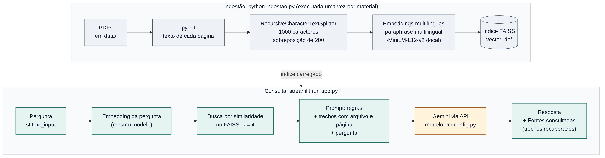
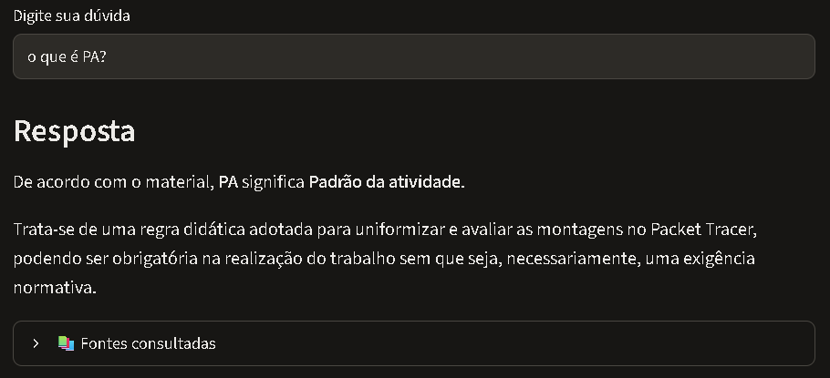

# Assistente de Estudos de Redes com RAG

Assistente de perguntas e respostas que responde com base em documentos técnicos em PDF sobre Redes de Computadores. Antes de gerar cada resposta, ele **recupera os trechos mais relevantes do material** e os envia ao modelo Gemini, e depois mostra de quais arquivos e páginas esses trechos vieram.

> **Projeto independente de estudo.** Não tem vínculo, parceria nem aprovação do SENAI ou de qualquer outra instituição. O PDF usado no desenvolvimento não é distribuído neste repositório (veja [Base de conhecimento](#base-de-conhecimento)).

## Sumário

- [Motivação](#motivação)
- [Como funciona](#como-funciona)
- [Funcionalidades](#funcionalidades)
- [Tecnologias](#tecnologias)
- [Arquitetura](#arquitetura)
- [Base de conhecimento](#base-de-conhecimento)
- [Estratégia de recuperação (RAG)](#estratégia-de-recuperação-rag)
- [Segurança e confiabilidade](#segurança-e-confiabilidade)
- [Demonstração](#demonstração)
- [Estrutura do projeto](#estrutura-do-projeto)
- [Instalação e execução](#instalação-e-execução)
- [Exemplos de perguntas](#exemplos-de-perguntas)
- [Limitações conhecidas](#limitações-conhecidas)
- [Testes](#testes)
- [Possíveis melhorias](#possíveis-melhorias)
- [Aprendizados técnicos](#aprendizados-técnicos)
- [Solução de problemas](#solução-de-problemas)
- [Créditos e referências](#créditos-e-referências)

## Motivação

Estudar a partir de PDFs longos significa procurar a explicação certa página por página. Um chatbot genérico responde rápido, mas não tem como saber o que está no *seu* material. Este projeto nasceu como um exercício prático para unir as duas coisas: usar um modelo de linguagem, mas obrigá-lo a se basear no conteúdo do documento e mostrar de onde a informação veio.

## Como funciona

O sistema tem duas etapas separadas:

1. **Ingestão (uma vez por material):** o texto de cada página do PDF é extraído, dividido em pedaços de até 1000 caracteres (com 200 de sobreposição), transformado em vetores numéricos (*embeddings*) e salvo em um índice FAISS local.
2. **Consulta (a cada pergunta):** a pergunta vira um vetor com o mesmo modelo, o FAISS devolve os 4 pedaços mais parecidos, e um prompt com esses pedaços e a pergunta é enviado ao Gemini. A resposta aparece na tela junto com os trechos recuperados e suas páginas.

O prompt instrui o modelo a responder **somente** com o contexto recebido e a dizer "Não encontrei essa informação nas apostilas." quando a resposta não estiver nele. Essa instrução existe no código; o quanto o modelo a obedece ainda está sendo avaliado (veja [Testes](#testes)).

## Funcionalidades

- Leitura de um ou mais PDFs da pasta `data/`, mantendo arquivo e número da página de cada trecho.
- Divisão do texto em pedaços com sobreposição.
- Embeddings multilíngues gerados localmente.
- Busca semântica no FAISS (k = 4 trechos por pergunta).
- Geração da resposta pelo Gemini a partir do contexto recuperado.
- Exibição dos trechos recuperados, com arquivo e página, em "Fontes consultadas".
- Interface web com Streamlit.
- Mensagens claras quando faltam o índice ou a chave da API.
- Parâmetros centralizados em `config.py` (tamanho dos pedaços, quantidade de trechos, modelos).

## Tecnologias

| Camada | Tecnologia | Uso no projeto |
|---|---|---|
| Linguagem | Python | todo o projeto |
| Modelo de linguagem | Google Gemini, via SDK `google-genai` | gera a resposta a partir do contexto |
| Orquestração | LangChain (`langchain-text-splitters`, `langchain-community`, `langchain-huggingface`) | divisão de texto, integração com FAISS e com o modelo de embeddings |
| Embeddings | `sentence-transformers/paraphrase-multilingual-MiniLM-L12-v2` | vetores que representam o significado dos textos, em português e outros idiomas |
| Banco vetorial | FAISS (`faiss-cpu`) | busca por similaridade, salvo em disco |
| Leitura de PDF | `pypdf` | extração do texto de cada página |
| Interface | Streamlit | chat web local |

O nome do modelo Gemini fica em `config.py` (`MODELO_GEMINI`), porque os provedores renovam os modelos com frequência.

## Arquitetura



Detalhes em [docs/ARCHITECTURE.md](docs/ARCHITECTURE.md).

## Base de conhecimento

- **O que o assistente sabe:** apenas o texto extraído dos PDFs que você colocar em `data/` e indexar. Ele **não** tem informações sobre cursos, matrículas, preços, inscrições ou unidades de nenhuma instituição.
- **O PDF não vem neste repositório.** A origem e a permissão de redistribuição do material usado no desenvolvimento não foram confirmadas, então nem o PDF nem o índice gerado a partir dele (`vector_db/`) são versionados. Use um material seu ou que você tenha autorização para usar.
- **Atualização:** coloque ou troque os PDFs em `data/` e rode `python ingestao.py` de novo. O índice é recriado do zero.

Mais detalhes em [docs/KNOWLEDGE_BASE.md](docs/KNOWLEDGE_BASE.md).

## Estratégia de recuperação (RAG)

| Etapa | O que o código faz | Onde |
|---|---|---|
| Obtenção | lê todos os `*.pdf` de `data/` | `ingestao.py` |
| Processamento | extrai o texto por página; ignora páginas sem texto | `ingestao.py` |
| Divisão | `RecursiveCharacterTextSplitter`, 1000 caracteres, sobreposição de 200, aplicado página por página | `ingestao.py`, `config.py` |
| Embeddings | modelo multilíngue executado localmente | `ingestao.py`, `config.py` |
| Armazenamento | índice FAISS salvo em `vector_db/` | `ingestao.py` |
| Recuperação | `similarity_search` com k = 4 | `rag.py` |
| Contexto | trechos (com `[arquivo, página N]`) + pergunta em um prompt de regras | `rag.py` |
| Geração | `generate_content` no Gemini | `rag.py` |
| Fontes | os 4 trechos recuperados são exibidos com arquivo e página | `app.py` |

Decisões de projeto e engenharia de prompt em [docs/RAG_DESIGN.md](docs/RAG_DESIGN.md).

## Segurança e confiabilidade

- A chave da API fica em um arquivo `.env` ignorado pelo Git. O repositório traz apenas o `.env.example`.
- O app não grava perguntas nem respostas. A pergunta e os trechos recuperados são enviados à API do Gemini para gerar a resposta.
- O prompt restringe a resposta ao contexto e define uma frase para quando não há resposta.
- **A fonte exibida é o trecho recuperado, não uma citação verificada.** Os 4 trechos enviados ao modelo aparecem em "Fontes consultadas", mesmo que o modelo não tenha usado todos.
- As respostas podem conter erros. Confira no trecho original em caso de dúvida.
- Riscos conhecidos (injeção de prompt, índice serializado com `pickle`) estão descritos em [docs/SECURITY.md](docs/SECURITY.md).

## Demonstração



Captura real do app rodando localmente: pergunta, resposta e o painel "Fontes consultadas" (fechado). O conteúdo da resposta vem do material indexado pelo autor.

## Estrutura do projeto

```text
.
├── app.py                 interface Streamlit
├── config.py              parâmetros do projeto e leitura do .env
├── ingestao.py            PDF -> pedaços -> embeddings -> índice FAISS
├── rag.py                 busca, montagem do prompt e chamada ao Gemini
├── testar_gemini.py       teste manual de conexão com a API
├── requirements.txt
├── .env.example           modelo do arquivo de configuração
├── .gitignore
├── data/                  coloque seus PDFs aqui (não versionados)
├── vector_db/             índice gerado (não versionado)
├── tests/
│   ├── test_prompt.py     testes unitários do prompt e da configuração
│   ├── test_ingestao.py   teste da divisão em pedaços
│   └── avaliar_rag.py     bateria de testes de comportamento (usa a API)
├── docs/
│   ├── ARCHITECTURE.md
│   ├── RAG_DESIGN.md
│   ├── KNOWLEDGE_BASE.md
│   ├── SECURITY.md
│   ├── TESTING.md
│   └── portfolio/         textos de divulgação e carrossel
└── assets/
    ├── diagrams/
    ├── screenshots/
    └── social/
```

## Instalação e execução

**Pré-requisitos:** Python 3.9 ou superior (testado pelo autor com Python 3.12 no Windows), conexão com a internet e uma chave da API do Gemini, criada em [Google AI Studio](https://aistudio.google.com).

```bash
# 1. Obtenha o código
git clone https://github.com/SEU-USUARIO/NOME-DO-REPOSITORIO.git
cd NOME-DO-REPOSITORIO

# 2. (Opcional) crie um ambiente virtual
python -m venv .venv
# Windows: .venv\Scripts\activate    |    Linux/Mac: source .venv/bin/activate

# 3. Instale as dependências
pip install -r requirements.txt
```

**Configuração da chave**

Copie `.env.example` para `.env` e coloque sua chave:

```text
GEMINI_API_KEY=cole_sua_chave_aqui
```

Nunca envie o `.env` ao GitHub.

**Uso**

```bash
# 4. Teste a conexão com o Gemini
python testar_gemini.py

# 5. Coloque seu PDF em data/ e crie o índice
python ingestao.py

# 6. (Opcional) teste a busca sem interface
python rag.py

# 7. Abra o chat em http://localhost:8501
python -m streamlit run app.py
```

Na primeira execução do passo 5, o modelo de embeddings (cerca de 470 MB) é baixado.

## Exemplos de perguntas

As respostas dependem do PDF que você indexar. Perguntas para experimentar:

- Uma pergunta cuja resposta você sabe que está no material (o autor testou "O que é PA?" com o seu PDF).
- Uma pergunta que o material não cobre, como "Quem ganhou a Copa do Mundo de 2022?". O comportamento esperado é a frase "Não encontrei essa informação nas apostilas.". Esse caso consta da bateria de testes e ainda não foi validado.

## Limitações conhecidas

- Cada pergunta é independente: **não há memória de conversa**.
- Responde apenas com base nos PDFs indexados. Não cobre cursos, matrículas, preços, inscrições nem unidades.
- PDFs escaneados (só imagem) são ignorados, porque não há OCR. Figuras e diagramas não são interpretados, apenas o texto.
- O texto é dividido página por página, então uma explicação que atravesse duas páginas é recuperada em partes.
- Sempre recupera 4 trechos, mesmo que nenhum seja relevante. Não há limite mínimo de similaridade.
- A qualidade das respostas ainda não foi medida de forma sistemática.
- Os trechos em "Fontes consultadas" são os recuperados, não necessariamente os usados pelo modelo.
- Roda localmente, para um usuário. Não foi publicado em nuvem.
- Os nomes dos modelos Gemini mudam. Se aparecer um erro 404 de modelo, atualize `MODELO_GEMINI` em `config.py`.

## Testes

| Teste | Situação |
|---|---|
| Conexão com o Gemini (`testar_gemini.py`) | Executado pelo autor: a API respondeu |
| Ingestão do PDF e criação do índice | Executada pelo autor com sucesso |
| App respondendo a uma pergunta com o painel de fontes | Executado pelo autor (conteúdo da resposta não conferido contra o PDF nesta documentação) |
| Testes unitários do prompt e da configuração | 11 testes escritos; passaram em ambiente de verificação com as bibliotecas pesadas simuladas. Execução com as bibliotecas reais: pendente |
| Teste da divisão em pedaços | Escrito; execução pendente |
| Bateria de comportamento (fora do escopo, ambígua, injeção de prompt) | Script pronto; execução pendente |

Como rodar e o relatório completo em [docs/TESTING.md](docs/TESTING.md).

```bash
python -m unittest discover -s tests -v
python tests/avaliar_rag.py
```

## Possíveis melhorias

São propostas, **ainda não implementadas**:

- Memória de conversa para perguntas de acompanhamento.
- Limite mínimo de similaridade, para não enviar trechos irrelevantes.
- Delimitar a pergunta do usuário no prompt como medida contra injeção de prompt.
- Citações ligadas à resposta, em vez de apenas listar os trechos recuperados.
- Conjunto de perguntas de referência para medir a qualidade da recuperação e das respostas.
- Reordenação dos resultados (reranking) ou busca híbrida.
- OCR para PDFs escaneados.
- Ingestão incremental, sem recriar todo o índice.

## Aprendizados técnicos

- **RAG de ponta a ponta:** separar a ingestão (offline) da consulta (online) e entender o papel de cada etapa: extração, divisão, embeddings, busca e geração.
- **Divisão de texto:** o tamanho do pedaço e a sobreposição afetam o que a busca consegue encontrar.
- **Embeddings:** como o significado vira vetor, e por que a pergunta precisa usar o mesmo modelo do índice. Foi escolhido um modelo multilíngue porque o material está em português.
- **Engenharia de prompt:** como restringir o modelo ao contexto, definir o comportamento quando não há resposta e identificar a origem de cada trecho.
- **Integração com APIs de IA:** a troca do SDK antigo (`google-generativeai`) pelo atual (`google-genai`) e a descontinuação de modelos mostraram a importância de isolar o nome do modelo na configuração.
- **Gestão de segredos:** `.env`, `.gitignore` e `.env.example`.
- **Ambiente de desenvolvimento:** resolver problemas reais de instalação no Windows (veja abaixo).

## Solução de problemas

| Problema | Causa e solução |
|---|---|
| `Could not install packages due to an OSError ... Long Path` ao instalar | O Windows limita o tamanho dos caminhos. Habilite caminhos longos (`LongPathsEnabled` no registro, como administrador), reinicie e rode o `pip install` de novo. |
| `'streamlit' não é reconhecido` | A pasta de scripts do Python não está no PATH. Use `python -m streamlit run app.py`. |
| `404 NOT_FOUND ... model is no longer available` | O modelo foi descontinuado. Troque `MODELO_GEMINI` em `config.py` por um modelo atual da [documentação do Gemini](https://ai.google.dev/gemini-api/docs/models). |
| `Banco vetorial não encontrado` | Rode `python ingestao.py` antes de abrir o app. |
| `Nenhum PDF encontrado` | Coloque um PDF na pasta `data/`. |
| Avisos sobre *symlinks* ao baixar o modelo | São apenas avisos do cache no Windows e não impedem o funcionamento. |

## Créditos e referências

- [Gemini API](https://ai.google.dev/gemini-api/docs) e [Google AI Studio](https://aistudio.google.com)
- [LangChain](https://python.langchain.com)
- [FAISS](https://github.com/facebookresearch/faiss)
- [Sentence Transformers](https://www.sbert.net) e o modelo [paraphrase-multilingual-MiniLM-L12-v2](https://huggingface.co/sentence-transformers/paraphrase-multilingual-MiniLM-L12-v2)
- [Streamlit](https://streamlit.io)
- [pypdf](https://pypdf.readthedocs.io)

Autor: Arthur. Adicione aqui o link do seu perfil.
"# networking-rag-assistant" 
