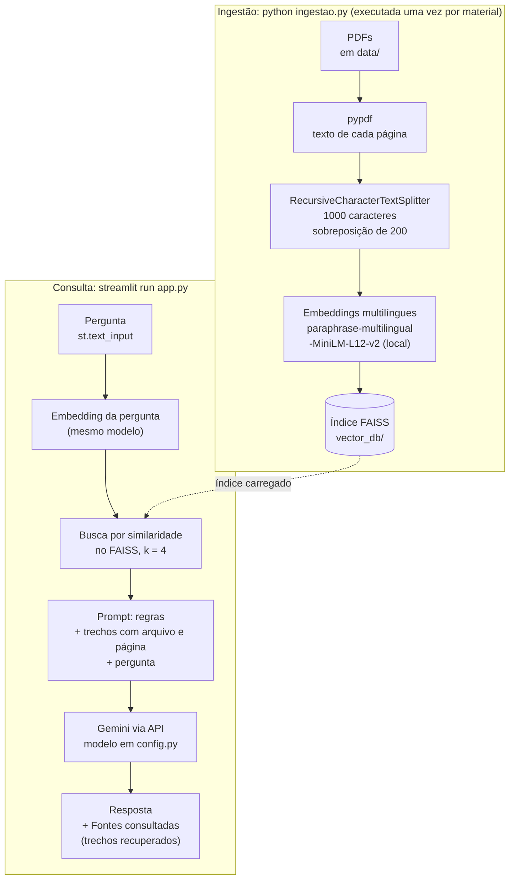

# Arquitetura

Este documento descreve os componentes que existem no código. Nada aqui é planejado: o que ainda não existe está em "O que não existe".

## Visão geral

Versão em imagem: `assets/diagrams/architecture.png` (fonte em `assets/diagrams/architecture.mmd`).

## Componentes

| Componente | Arquivo | Responsabilidade |
|---|---|---|
| Interface | `app.py` | campo de pergunta, spinner, resposta e painel de fontes (Streamlit) |
| Configuração | `config.py` | pastas, tamanho dos pedaços, modelos, quantidade de trechos; lê o `.env` |
| Ingestão | `ingestao.py` | lê PDFs, divide o texto, cria embeddings e salva o índice |
| Recuperação e geração | `rag.py` | carrega o índice, busca os trechos, monta o prompt e chama o Gemini |
| Teste de conexão | `testar_gemini.py` | confirma que a chave e o modelo funcionam |
| Modelo de linguagem | API do Gemini (externo) | gera o texto da resposta |
| Modelo de embeddings | `sentence-transformers` (local) | transforma texto em vetores |
| Armazenamento | `vector_db/` (FAISS, local) | guarda os vetores, os textos e os metadados (arquivo e página) |

## Fluxo de uma pergunta

1. O usuário digita a pergunta em `app.py`.
2. `app.py` chama `gerar_resposta(banco, cliente, pergunta)` em `rag.py`.
3. `buscar_trechos` chama `banco.similarity_search(pergunta, k=QTD_TRECHOS)`. O LangChain transforma a pergunta em vetor com o mesmo modelo de embeddings da ingestão e devolve os 4 pedaços mais próximos.
4. `montar_prompt` junta as regras, os trechos (cada um precedido por `[arquivo, página N]` e separados por `---`) e a pergunta.
5. `cliente.models.generate_content` envia o prompt ao Gemini.
6. `app.py` mostra o texto da resposta e, em "Fontes consultadas", os 4 trechos com arquivo e página.

## Inicialização e desempenho

O Streamlit reexecuta o script a cada interação. Por isso `iniciar()` usa `@st.cache_resource`: o modelo de embeddings e o índice são carregados uma única vez por sessão do servidor.

## Tratamento de erros

| Situação | Comportamento |
|---|---|
| Sem `vector_db/index.faiss` | `rag.py` levanta `FileNotFoundError`; `app.py` mostra a mensagem e para |
| Sem `GEMINI_API_KEY` | `rag.py` levanta `RuntimeError`; `app.py` mostra a mensagem e para |
| Falha ao gerar a resposta (rede, cota, modelo inexistente) | `app.py` mostra "Ocorreu um erro ao gerar a resposta" seguido da mensagem original da exceção |
| Nenhum PDF em `data/` | `ingestao.py` avisa e encerra |
| Página do PDF sem texto | é ignorada na ingestão |

## Implantação

Execução local, para um usuário. Não há backend separado do frontend, banco de dados relacional, autenticação, nem implantação em nuvem.

## O que não existe

Memória de conversa, uso de ferramentas (*function calling*), decisão autônoma de passos, OCR, autenticação, registro de perguntas, limite de similaridade, reordenação de resultados e testes automatizados do comportamento do modelo (existe um script para execução manual: `tests/avaliar_rag.py`).
